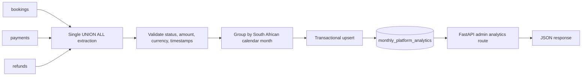

# Data Engineering Assessment: Demonstration Guide

## A. Demonstration objective

Demonstrate a repeatable pipeline that extracts real operational bookings, payments and
refunds from PostgreSQL, validates and aggregates them, persists derived monthly records,
and serves those records from an authenticated FastAPI endpoint. The implementation is a
small ETL flow in the existing Car Rental application, not a separate warehouse.

## B. Repository audit and architecture

Verified before implementation:

- The application already had PostgreSQL operational tables for `bookings`, `payments` and
  `refunds`, Alembic migrations, and administrator-only live reports.
- The administrator reports calculate values on request; there was no persisted ETL
  snapshot, analytics refresh command or dedicated analytics endpoint.
- The operational schema contains exact ZAR money amounts, checked booking/payment/refund
  statuses, payment `paid_at` times, and processed-refund timestamps.
- The configured local development database was empty before migrations were applied.
  The test database is the separate `car_rental_test` database and is used only by tests.

The implemented path is:



The three sources are extracted in one SQL statement and are not joined, avoiding row
multiplication from one-to-many payment/refund relationships. PostgreSQL streams the
result in batches; Python aggregation retains only the month buckets in memory.

### Metric definitions and limitations

| Metric | Definition | Source and handling |
|---|---|---|
| `bookings_created` | Number of bookings created in the month | `bookings.created_at`; counts every current booking status |
| `bookings_by_current_status` | Those bookings grouped by their status at refresh time | Not a historical status-at-month-end measure |
| `cash_collected` | Gross captured payment amounts in the month funds were recorded | `payments.amount` where `paid_at` is set; uses the payment timestamp, not booking total or booking status |
| `cash_refunded` | Successfully processed refund amounts in the month funds were returned | `refunds.amount` only when status is `PROCESSED`, using `processed_at` |
| `net_cash` | `cash_collected - cash_refunded` | Cash-flow measure; may be negative in a month when refunds relate to older payments |

All months use `Africa/Johannesburg` calendar boundaries. Currency is ZAR. A pending
payment/refund is not counted as a cash flow. These are platform cash aggregates, not
accounting revenue, profit, commission or owner payout. The full refresh is intentional:
the source schema does not provide complete immutable change events/watermarks for
booking status and cash-flow corrections.

The development database currently contains no bookings, payments or refunds. The
pipeline and endpoint have been integration-tested with isolated test fixtures, but a
non-empty assessment demonstration must use records created through the real application
flows. Do not use `seed-demo-data` as proof of a real-data pipeline.

## C. Prerequisites

- Python 3.12 and the project backend virtual environment/dependencies.
- Docker Compose with the project's PostgreSQL 16 service.
- Local root `.env` and `backend/.env`, created from the respective `.env.example` files;
  keep credentials local and never paste them into assessment materials.
- Alembic schema at the current head.
- An administrator account for the protected analytics endpoint.
- For cash-flow examples, a payment recorded through the configured test payment provider.
  Do not enable live payments for the demonstration.

## D. Startup instructions

From the repository root, start the local database:

```bash
docker compose up -d db
docker compose ps
```

Apply migrations from `backend/`:

```bash
cd backend
python -m alembic upgrade head
```

Start the API in a separate terminal, also from `backend/`:

```bash
cd backend
python -m uvicorn app.main:app --reload --port 8000
```

Confirm the API and database connection:

```bash
curl --fail-with-body http://localhost:8000/api/v1/health
```

The health endpoint verifies database connectivity, not that every table exists; migration
state is checked separately with `python -m alembic current`.

Create an administrator if this database has none. Run from `backend/`; the password is
prompted interactively and should not be placed in shell history:

```bash
python -m app.cli create-admin --email <admin-email> --full-name "<admin-name>"
```

Prepare actual source records through the app: register an owner and renter, complete the
vehicle submission and administrator approval/pricing workflow, and create bookings. To
show cash calculations, complete a payment with a test provider and, if useful, process a
refund. These are ordinary application records, not seeded analytics output.

## E. Pipeline execution

From `backend/`:

```bash
python -m app.cli analytics-refresh
```

On success, output reports the number of source bookings, payments, refunds and months
loaded. The command commits after the complete refresh succeeds. Validation or database
errors are surfaced and return a non-zero process status; the previous derived snapshot
remains protected by transaction rollback.

The verified local run completed with:

```text
Analytics refresh complete: 0 booking(s), 0 payment(s), 0 refund(s), 0 month(s) loaded.
```

That zero-row result is accurate for the current development database, not evidence of
non-empty analytics.

## F. Database verification

Connect to the configured development database with `psql` or a PostgreSQL client. For
the default Compose configuration, the connection is localhost port 5433; use the local
database username/database configured for your environment and enter its password only
at the client prompt.

Inspect the source status counts independently:

```sql
SELECT to_char(timezone('Africa/Johannesburg', created_at), 'YYYY-MM') AS month,
       status,
       count(*) AS bookings
FROM bookings
GROUP BY 1, 2
ORDER BY 1, 2;
```

Inspect captured cash without joining to bookings:

```sql
SELECT to_char(timezone('Africa/Johannesburg', paid_at), 'YYYY-MM') AS month,
       sum(amount) AS cash_collected
FROM payments
WHERE paid_at IS NOT NULL
GROUP BY 1
ORDER BY 1;
```

Inspect successfully returned cash independently:

```sql
SELECT to_char(timezone('Africa/Johannesburg', processed_at), 'YYYY-MM') AS month,
       sum(amount) AS cash_refunded
FROM refunds
WHERE status = 'PROCESSED'
  AND processed_at IS NOT NULL
GROUP BY 1
ORDER BY 1;
```

Inspect the materialised-by-command snapshot (a normal table, not a PostgreSQL
materialized view):

```sql
SELECT to_char(month_start, 'YYYY-MM') AS month,
       bookings_created,
       bookings_by_current_status,
       cash_collected,
       cash_refunded,
       net_cash,
       currency,
       refreshed_at
FROM monthly_platform_analytics
ORDER BY month_start;
```

For each month, verify that `bookings_created` equals the sum of its status counts and
that `net_cash = cash_collected - cash_refunded`. The three source queries deliberately
have separate grains, so payment totals are not multiplied by refunds.

## G. API verification

Authenticate as an administrator through `POST /api/v1/auth/login` (Swagger UI at
`http://localhost:8000/docs` can be used in development), then call:

```bash
curl --fail-with-body \
  -H "Authorization: Bearer ${ACCESS_TOKEN}" \
  "http://localhost:8000/api/v1/admin/analytics/monthly?months=12"
```

`months` is optional (default 12; accepted range 1–120). The endpoint is restricted to
administrators; an unauthenticated call returns 401 and a non-admin returns 403.
Database errors are not converted into an empty success response.

Representative response values verified by the automated integration test (isolated test
fixtures, not current live operational data):

```json
{
  "items": [
    {
      "month": "YYYY-MM",
      "bookings_created": 1,
      "bookings_by_current_status": {
        "PENDING_PAYMENT": 0,
        "CONFIRMED": 1,
        "CANCELLED": 0,
        "EXPIRED": 0,
        "DELIVERY_SCHEDULED": 0,
        "IN_TRANSIT": 0,
        "DELIVERED": 0,
        "ACTIVE_RENTAL": 0,
        "RETURN_PENDING": 0,
        "COMPLETED": 0
      },
      "cash_collected": "1000.00",
      "cash_refunded": "250.00",
      "net_cash": "750.00",
      "currency": "ZAR",
      "refreshed_at": "<database refresh timestamp>"
    }
  ],
  "months_requested": 12,
  "basis": "Booking counts use booking creation month and current status at refresh time. Cash collected uses payment paid_at; cash refunded uses processed refund processed_at. Payments without paid_at and refunds not processed are excluded."
}
```

The fixture test verifies those amount values and status counts. The real local development
database currently has no source records, so after refresh it contains no monthly rows; a
real authenticated request on that database should return an empty `items` array until
actual app records are present.

## H. Data correctness and quality

The implementation applies these checks before writing output:

| Rule | Why | Failure and diagnosis |
|---|---|---|
| Source statuses must belong to the application's booking/payment/refund enums | Prevents unknown states being silently omitted or misclassified | Abort the whole refresh with source and record ID; inspect the source row and enum/check constraints |
| Payment/refund amount must be finite and positive | Avoids invalid monetary aggregation | Abort; compare the source amount with the model's positive-amount constraint |
| Payment/refund currency must be ZAR | Prevents summing unlike currencies | Abort; inspect the source currency and its database check |
| A succeeded payment must have `paid_at`; a processed refund must have `processed_at` | Cash cannot be assigned to an event month without the event timestamp | Abort; inspect payment/refund status and provider reconciliation |
| Booking creation time must exist | Every booking count needs a month bucket | Abort; check the non-null database column and source record |

The schema additionally enforces primary-key uniqueness, foreign keys, booking date/amount
consistency, and status checks. The pipeline uses those database guarantees rather than
duplicating a full-table uniqueness or referential-integrity scan. It does not discard
invalid rows; one invalid record rejects the refresh. Error logs identify the source type
and record ID, not renter contact details.

## I. Safe failure demonstration

Run the parameterized unit tests that feed invalid monetary values directly into the
pipeline's validation helper; they do not insert malformed data into PostgreSQL:

```bash
cd backend
python -m pytest tests/analytics/test_pipeline.py::test_invalid_money_is_rejected -q
```

The expected result is four passing cases (missing, zero, negative and non-finite amounts).
The helper raises `PipelineDataQualityError`. Real invalid enum/currency/amount rows are
also normally rejected earlier by PostgreSQL constraints; do not disable those constraints
or alter live records for a demonstration.

## J. Repeatability

Execute the command twice:

```bash
python -m app.cli analytics-refresh
python -m app.cli analytics-refresh
```

The unique key is `month_start`; each run uses PostgreSQL `INSERT ... ON CONFLICT DO
UPDATE`. Months no longer present in the complete source scan are removed from the
derived table in the same transaction. Source tables are read-only to this command.
Verify that each month occurs once and that the totals match the independent source SQL.
An empty source set produces zero output rows.

## K. Troubleshooting

- **`relation "bookings" does not exist`:** from `backend/`, run
  `python -m alembic upgrade head`; check `python -m alembic current`.
- **PostgreSQL connection error:** start Compose with `docker compose up -d db`; compare
  local host/port/database settings without printing credentials.
- **Refresh says zero rows:** inspect the source counts first. Do not treat empty analytics
  as proof that an upstream import or app flow succeeded.
- **401 / 403 from analytics endpoint:** use an administrator access token; ordinary
  renter/owner tokens are intentionally denied.
- **Snapshot looks stale:** rerun `python -m app.cli analytics-refresh`, then compare the
  independent SQL results and `refreshed_at`.
- **Data-quality failure:** use the reported source and record ID to inspect only the
  relevant status, amount, currency and timestamp fields. Correct source data through the
  normal application/provider workflow; do not edit the analytics table by hand.
- **Test suite reports database safety error:** `TEST_DATABASE_URL` must refer to the
  dedicated database ending in `_test`. Its schema is dropped and recreated by migrations
  during tests; never point it at the development or production database.
